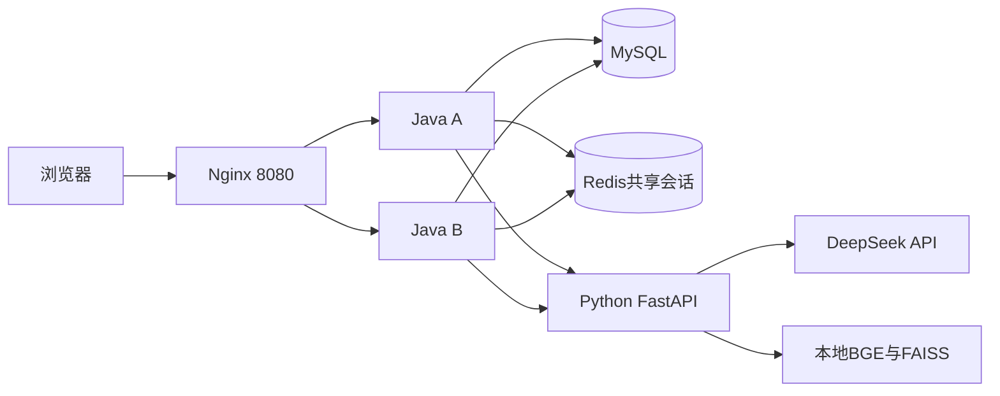

# ShopAgent · 跳糖选物

项目仓库：[wzh5176-stack/ShopAgentX](https://github.com/wzh5176-stack/ShopAgentX)。本仓库保留原有开发历史及MIT LICENSE，迁移范围见[仓库迁移说明](docs/GITHUB_MIGRATION.md)。

交易新版已完成本地VMware Linux部署验收，入口 http://127.0.0.1:8080/shopagent/home.html 。原库备份并隔离恢复验证后增量升级到12表；部署验收时双Java/Nginx/Redis/MySQL/AI共6容器健康，此记录不代表服务当前正在运行。运行、备份、回退及沙箱验收边界见[新版运行说明](docs/TRADE_DEPLOYMENT.md)。临时通知隧道有会话限制，不能作为生产固定域名；Linux未代付新单，真实官方待付款主动关单仍未实测。

商品浏览、购物车与AI导购结合的学习实践项目。Java负责可信业务与数据，Python负责模型和检索，网页提供商品浏览、多轮聊天、资料问答和人工确认操作。

当前首版已完成核心功能、本地Linux容器部署与下述演练，成果记录截至2026-10-22。项目参考[ShopAgent-X](https://github.com/EvanYao826/ShopAgent-X)的设计和学习路线，具体阅读范围见[参考笔记](docs/REFERENCE_GUIDE.md)；本仓库的实现范围以自身代码和验收记录为准。

## 第二版交易扩展进展

本机后端已完成地址、订单库存和本地模拟支付：可信核价/幂等快照、本人列表详情、取消与自动超时、模拟成功/失败重试、持久结果回执、重启与后台查单补偿。历史技术验收见[模拟支付验收](docs/MOCK_PAYMENT_ACCEPTANCE.md)、[官方付款入口](docs/ALIPAY_CHECKOUT_ACCEPTANCE.md)、[查单结算](docs/ALIPAY_QUERY_ACCEPTANCE.md)、[关单协调](docs/ALIPAY_CLOSE_ACCEPTANCE.md)与[通知及交易页面](docs/TRADE_COMPLETION_ACCEPTANCE.md)。真实沙箱付款通知、漏通知补偿和未建交易的过期回收已验证，交易新版已增量部署Linux；真实待付款主动官方关单仍待验。各阶段重叠检查不相加作为总测试数。

2026-10-25新增标准自动化回归、隔离MySQL事务/并发测试及GitHub Actions配置，使用说明见[自动化回归](docs/REGRESSION.md)。SQL历史分类、指纹与空库结构基线见[数据库迁移约定](backend/db/README.md)。

2026-10-25新增36款逐型号演示商品与说明书，资料问答可从详情页选择商品，并在该型号内检索、返回带版本原文。管理员补货、库存展示、导购缺货过滤及标准回归已合并升级至现有Linux环境；维护与验收见[库存闭环](docs/INVENTORY_CLOSURE.md)和[商品资料与RAG](docs/CATALOG_RAG.md)。

## 已实现

- 商品：公开列表、关键词搜索、分页与详情；管理员新增、修改、上下架和逻辑删除。
- 库存：管理员幂等补货与不可覆盖的操作记录、当前可售数量展示、缺货导购过滤；下单事务继续核对并预占库存。
- 账号：注册、登录、退出、角色授权和CSRF保护；用户会话及购物车按身份隔离。
- 导购：从真实商品候选中推荐、预算条件、多轮上下文、流式输出及消息历史。
- 资料问答：36款演示商品资料及独立K1样例，本地BGE与FAISS按型号检索、版本原文引用、型号冲突澄清与无依据处理。商品参数和图片明确为虚构演示。
- 购物车：常规读取/设置总数量/移除；自然语言生成待确认操作，确认后由Java执行，支持操作状态和历史恢复。
- 交易：收货地址、服务端核价、库存预占、幂等下单、订单历史、取消与超时回收；本地模拟支付及支付宝官方沙箱。
- 部署：Docker Compose组织MySQL、Redis、Python、双Java实例与Nginx；Spring Session共享登录会话。
- 演练：单Java实例停止与恢复；独立RedisCluster三主三从、分片复制与主故障提升；业务SQL备份及隔离恢复。

当前不含物流履约、退款、正式收款、Android客户端或LangGraph图编排。RedisCluster是独立实验，网站共享会话仍使用原单节点Redis；单VM部署保留基础设施单点，未做公网生产上线。

## 技术组成

| 部分 | 实际使用 |
| --- | --- |
| Java业务 | Java17、Spring Boot4.1.1、Spring Security、MyBatis-Plus3.5.17 |
| AI服务 | Python3.12、FastAPI、Pydantic、HTTPX、DeepSeek官方API |
| 本地检索 | BGE-small-zh-v1.5、sentence-transformers、FAISS CPU |
| 页面 | HTML/CSS/JavaScript，Java静态资源目录提供 |
| 数据与会话 | MySQL8.4.11、Redis7.4.11、Spring Session |
| 演示运行 | VMware Ubuntu24.04、Docker Engine/Compose、Nginx1.30.2 |

详细依赖分别固定在[Java依赖](backend/pom.xml)、[Python依赖](ai-service/requirements.txt)及[向量依赖](ai-service/requirements-embedding.txt)。未使用React/Vue、JWT或Spring Cloud服务治理套件。

## 运行结构



浏览器通过Java业务入口操作；Python返回模型结果，Java负责权限、商品与操作复核以及数据库提交。集群与恢复实验使用单独Compose，不在图中的网站服务链上。

## 目录

| 路径 | 内容 |
| --- | --- |
| backend/src/main/java | Java Controller、Service、Mapper、DTO和实体 |
| backend/src/main/resources/static/shopagent | 跳糖选物页面及保留的其他设计 |
| backend/sql | 建表、演示数据、迁移和阶段性授权练习 |
| ai-service | 模型调用、多轮意图、候选选择、流与RAG |
| deploy | Docker构建/运行配置、实验Compose与测量脚本 |
| docs | 设计、接口、手动教学、验收和复盘记录 |
| PROJECT_STATE.md | 长聊恢复时的最新进度 |

SQL编号包含迁移和授权步骤，执行时应按[数据库设计](docs/DATABASE_DESIGN.md)与[迁移约定](backend/db/README.md)确认目标，不在已有库重放整个目录；结构基线只用于空库。

## 已配置本机环境的启动

以下是当前已准备镜像、数据库、模型及私密运行配置的环境，不是新克隆仓库的一键初始化命令。

1. 启动ShopAgent的Ubuntu虚拟机；按本机约定先停止eNSP设备。
2. SSH登录Linux，进入实际部署目录，启动网站：

```bash
cd /home/shopagent/shopagent/deploy
sudo sh runtime.sh up -d --wait --wait-timeout 240
sudo sh runtime.sh ps
```

3. Windows另开PowerShell，保持网页转发：

```powershell
ssh -F "D:\VMware work\ShopAgent-Ubuntu24\access\ssh_config" -N -T -L 127.0.0.1:8080:127.0.0.1:8080 -o ExitOnForwardFailure=yes -o ServerAliveInterval=15 -o ServerAliveCountMax=3 shopagent-linux
```

4. 浏览器访问[商城首页](http://127.0.0.1:8080/shopagent/home.html)。

IDEA/PyCharm内的开发服务无需同时启动。上述WindowsSSH配置路径属于当前开发机，其他机器需自行配置连接。

首次准备环境可依次参考[Java镜像](docs/JAVA_IMAGE_BUILD_MANUAL_STEP.md)、[Python镜像](docs/PYTHON_IMAGE_BUILD_MANUAL_STEP.md)、[本地模型](docs/EMBEDDING_MODEL_MOUNT_MANUAL_STEP.md)、[MySQL容器](docs/MYSQL_CONTAINER_MANUAL_STEP.md)、[应用账号](docs/MYSQL_RUNTIME_USER_MANUAL_STEP.md)、[Java容器配置](docs/JAVA_CONTAINER_CONFIG_MANUAL_STEP.md)、[模型密钥](docs/DEEPSEEK_CONTAINER_KEY_MANUAL_STEP.md)与[完整Compose](docs/RUNTIME_COMPOSE_MANUAL_STEP.md)。新环境需准备数据库结构/演示数据与权限；仓库不提供真实账号数据备份或密钥。

## 页面与代表接口

页面：[首页](http://127.0.0.1:8080/shopagent/home.html)、[商品](http://127.0.0.1:8080/shopagent/products.html)、[AI导购](http://127.0.0.1:8080/shopagent/play.html)、[资料问答](http://127.0.0.1:8080/shopagent/knowledge.html)、[购物车](http://127.0.0.1:8080/shopagent/cart.html)。

| 方法与路径 | 用途 |
| --- | --- |
| GET /api/health | 本地业务服务健康，不调用模型 |
| GET /api/products、/api/products/{id} | 公开商品查询 |
| POST /api/auth/register、/api/auth/login | 注册与登录，登录由Security过滤器处理 |
| GET /api/auth/me、POST /api/auth/logout | 当前身份与退出 |
| GET /api/csrf | 获取当前CSRF信息 |
| GET /api/cart、PUT/DELETE /api/cart/items/{productId} | 本人购物车 |
| POST /api/conversations | 创建本人会话 |
| GET /api/conversations/{conversationId}/messages | 历史消息 |
| POST /api/conversations/{conversationId}/messages/stream | 多轮导购流 |
| POST /api/conversations/{conversationId}/turns | 根据真实推荐来源生成操作/澄清等结果 |
| POST /api/conversations/{conversationId}/cart-actions/{operationId}/confirm | 确认本人操作单 |
| POST /api/assistant/knowledge | 资料问答 |
| /api/admin/products | 管理员商品管理 |

账号基于Cookie/HttpSession与角色权限，写请求保留CSRF。请求与响应详情见[接口约定](docs/API_CONTRACT.md)，实际路由以Controller和SecurityConfig为准。

## 验收与实测

| 内容 | 记录 |
| --- | --- |
| 商城与工作台 | [商城验收](docs/STOREFRONT_ACCEPTANCE.md)、[工作台验收](docs/WEB_WORKSPACE_ACCEPTANCE.md) |
| 多轮与流 | [流式协议/业务验收](docs/CONVERSATION_STREAM_ACCEPTANCE.md) |
| 工具操作与历史 | [操作单](docs/CART_ACTION_ACCEPTANCE.md)、[工具消息](docs/TOOL_MESSAGE_ACCEPTANCE.md) |
| 真实模型演示 | [模型与知识网页演示](docs/KNOWLEDGE_WEB_AND_REAL_DEMO_ACCEPTANCE.md)、[运行手册](docs/RUNTIME_RUNBOOK.md)中的本轮反馈 |
| 独立集群 | [RedisCluster验收](docs/REDIS_CLUSTER_ACCEPTANCE.md) |
| 备份恢复 | [隔离恢复验收](docs/MYSQL_RESTORE_CHECK_ACCEPTANCE.md) |
| 商品接口基线 | [实测条件与结果](docs/PRODUCT_BASELINE_REPORT.md) |

本轮商品查询：2vCPU/4GiB配置VM、6个商品/4个在售、预热5次后30次串行请求，30/30成功，平均9.89ms、P9514.94ms、最大17.49ms；两上游各15次。101.08次/s为该小样本实际速率，不是最大QPS，没有高并发或双实例提速结论。数字来自用户终端，脚本已核，未保留原始逐请求耗时。

验收文档区分用户实际网页反馈、受控模型技术测试与助手独立只读检查，不累加各阶段重叠检查数来宣称总测试量。

## 日常停止与复习

Linux：

```bash
cd /home/shopagent/shopagent/deploy
sudo sh runtime.sh stop
sudo shutdown -h now
```

看到虚拟机正常关闭后再关闭VMware窗口。实验集群和恢复库当前均停止；以后复习按其独立Compose启动，不再执行集群create或向非空库重复恢复。

更多：[运行手册](docs/RUNTIME_RUNBOOK.md)、[演示与复盘](docs/DEMO_AND_REVIEW.md)、[贡献及简历草稿](docs/CONTRIBUTION_AND_RESUME.md)。

导购源码按1→6顺序复习：[一次导购请求的六步完整流程](docs/GUIDE_REQUEST_SIX_STEPS.md)，包含请求字段、关键代码、等价SQL、流式事件、事务和历史恢复。

## 参考与贡献

采用参考项目阅读、逐步教学和AI辅助开发。后端与部署按教学步骤由学习者手动实现/操作，前端与部分接线和修复由AI辅助完成，验收记录保留具体来源。个人职责应按[贡献说明](docs/CONTRIBUTION_AND_RESUME.md)陈述；不将参考仓库全部功能或独立实验写成网站已实现能力。

